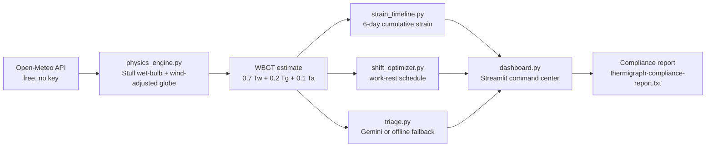
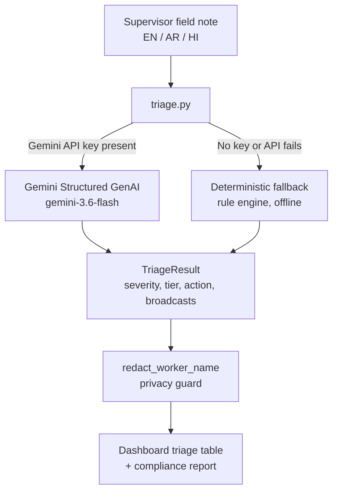

# ThermiGraph AI


**Temporal Biometeorological & Field-Triage Engine (Global Health Edition)**
*Future Health Digital Innovation Challenge 2026 — Track: `[Population Health] Climate-Resilient Worker Health`*

Live JS dashboard: https://chipper-halva-04403d.netlify.app/ (v15, see `thermigraph-js-v15.zip` in the workspace). Demo video: https://youtu.be/iv_KnkdgBH0 (2:53). Clinical evidence: `clinical-evidence-brief.md` at repo root. Context: see `docs/commercial-comparison.md` for why a weather-derived estimate is worth building alongside Kestrel, Extech, and Questemp meters. Docs: `docs/API.md`, `docs/FAQ.md`, `docs/data-governance.md`.

> CI badge above: check it renders green on GitHub. It was not verified live from this workspace, which is not a git repo.

---

## 1. Problem & Clinical Rationale ("From Signals to Solutions")

Occupational heat collapse and heat-induced kidney strain rarely result from a single hot hour in isolation. Clinically, they are driven by **multi-day cumulative physiological debt**: thermal and cardiovascular strain builds across consecutive shifts, **overnight recovery fails** when nocturnal minimum temperatures remain above **28.0 °C**, and acute decompensation occurs on Day 3 or Day 4.

**ThermiGraph AI** turns fragmented environmental, temporal, and field-supervisor signals into early, non-punitive workplace interventions—featuring a dedicated **Abu Dhabi Host Pilot Corridor** (**Mussafah**, **KEZAD / Khalifa Port**, **Ruwais**) alongside **Global Health Sentinel Corridors** (**Lagos**, **Delhi NCR**, **Houston**, and any custom GPS coordinates worldwide):

1. **Multi-Zone Wind-Adjusted Biometeorological Sensing (`physics_engine.py`):** Pulls live temperature, relative humidity, 10 m wind speed, and hourly shortwave solar radiation (W/m²) from Open-Meteo (zero API key or wearable hardware required) to compute psychrometric Wet-Bulb Temperature (T_w, Stull formula), convective wind-adjusted Black Globe Temperature (T_g), and Outdoor Wet-Bulb Globe Temperature (WBGT = 0.7 T_w + 0.2 T_g + 0.1 T_a) against NIOSH continuous work limits.
2. **6-Day Cumulative Thermal Strain & Nocturnal Recovery Debt (`strain_timeline.py`):** Evaluates a 6-day rolling window (past 3 days + today + next 2 days) in local site timezone (`timezone="auto"`), flagging **Nocturnal Recovery Debt** when overnight minimum temperatures (00:00–05:59) exceed **28.0 °C** and computing a cumulative strain index (red-line threshold >= 12).
3. **Automated Work-Rest & Shift Optimizer with Path-to-Pilot KPIs (`shift_optimizer.py` & `dashboard.py`):** Generates an hourly shift plan (06:00–17:00) that front-loads heavy labour into the lower-WBGT morning window (06:00–10:00), enforces dynamic work-rest micro-rotations (45/15, 30/30, or full suspension above 28.0 °C WBGT), schedules a recommended midday shade break (12:30–15:00), rotates anonymised crews (`Crew A` and `Crew B`), and quantifies prevented unsafe heavy-work hours and scheduled cooling minutes.
4. **Privacy-Preserving Multilingual AI Field-Log Triage (`triage.py`):** Uses the `google-genai` SDK with a strict Pydantic `response_schema` (`TriageResult`) and an offline deterministic clinical fallback engine to parse unstructured English, Arabic, and Hindi/Urdu supervisor notes alongside live site WBGT—extracting symptom severity, hydration/anhydrosis markers, PPE friction, occupational risk tier, immediate action, and Arabic + Hindi/Urdu crew safety broadcasts while deterministically redacting worker names (`redact_worker_name`).
5. **Interactive Global Command Center & Heatwave Simulator (`dashboard.py`):** Unifies all modules in a Streamlit dashboard featuring the 3 Abu Dhabi host pilot zones, a Global Worksite & Custom GPS Selector, a `+0 °C to +10 °C` **Heat Spike Simulator**, three clinical field scenarios, and an exportable compliance report (`thermigraph-compliance-report.txt`).

---

## 2. Repository Structure

| File | Role |
| :--- | :--- |
| `dashboard.py` | Unified Streamlit web app integrating the Abu Dhabi host pilot corridor, Global Worksite Selector, Heat Spike Simulator, 6-day strain timeline, Shift Optimizer KPIs, multilingual triage, compliance report export, compare-sites view, Impact/ROI panel, cost-of-inaction calculator, and worker-facing view. |
| `dashboard_logic.py` | Pure business logic for the dashboard (timeline/strain, shift schedule, compare-sites, cost-of-inaction, ISO cross-check), free of Streamlit imports so it can be unit-tested with plain pytest. |
| `physics_engine.py` | Module 1: Stull wet-bulb equation, convective wind-adjusted solar black-globe approximation, outdoor WBGT calculation, and NIOSH workload threshold checks. |
| `strain_timeline.py` | Module 2: 6-day rolling hourly WBGT analysis, Nocturnal Recovery Debt (> 28.0 °C) detection, and Cumulative Thermal Strain Index. |
| `triage.py` | Module 3: Structured `google-genai` Pydantic extraction (`TriageResult`), deterministic offline fallback, regex name redaction, and Arabic + Hindi/Urdu crew broadcasts. |
| `shift_optimizer.py` | Module 4: Hourly work-rest ratio scheduler and anonymised `Crew A` / `Crew B` rotation engine. |
| `fetch_mussafah.py` | Lightweight CLI connectivity verification script for live Mussafah Open-Meteo telemetry. |
| `test_thermigraph.py` | Automated `pytest` verification suite (17 tests: 15 original plus 2 clothing-correction tests). |
| `test_validation.py` | Validation suite (9 tests: 8 original plus 1 psychrometric table test, 10 values at 35 C, max deviation 0.64 C). |
| `bench.py` | Benchmark: 100,000 WBGT estimates, measured 670,718 estimates/second on 2026-11-16 (about 1.5 microseconds per call). |
| `physics_engine.py` | Module 1, now with clothing correction: effective WBGT = raw WBGT + correction (light 0, coveralls +1, construction PPE +2, impermeable suit +4), ISO 7243 Annex C simplified. |
| `docs/commercial-comparison.md` | Why a weather-derived estimate is worth building, with verified prices (Kestrel 5400 $549, Extech HT30 $219 list, TSI Questemp 34 $3,940, checked 2026-11-16). |
| `docs/data-governance.md` | Data governance statement: no persistent storage, name redaction, Gemini disclosure. |
| `docs/API.md` | API reference for all modules. |
| `docs/FAQ.md` | Frequently asked questions. |
| `docs/future-health-evidence-excerpt.md` | Clinical evidence text ready to paste into the Future Health submission. |
| `docs/screenshots-checklist.md` | Six Future Health gallery screenshots plus mobile shots, with exact steps. |
| `SECURITY.md`, `CONTRIBUTING.md`, `CODE_OF_CONDUCT.md` | Security policy, contributing guide, Contributor Covenant v2.1. Fill in the contact email placeholder before publishing. |
| `coverage-note.md` | Measured coverage: 47% total (dashboard_logic 95%, triage 68%, physics 53%). No Codecov badge, coverage is below the level a badge would honestly show. |
| `liljegren-note.md` | Why Liljegren was NOT added: pythermalcomfort `wbgt()` takes wet bulb as input and its wet-bulb function is Stull, so a Liljegren method would be Stull-vs-Stull. Stull remains the only method. |
| `requirements.txt` | Python dependencies (pinned `streamlit`, `google-genai`, `pytest`; minimum versions for the rest; optional `pythermalcomfort` and `plotly`). |
| `.gitignore` | Ignores `.env`, `__pycache__`, `.venv`, and Streamlit secrets. |
| `.env.example` | Template for the local `.env` file (`GEMINI_API_KEY=` placeholder). |
| `Dockerfile` | Container image for running the dashboard on port 8501. |
| `.github/workflows/ci.yml` | GitHub Actions CI: installs dependencies and runs `pytest` on every push to `main`. |
| `CHANGELOG.md` | Version history (v1 through v6). |

---

## 3. Explicit Assumptions, Clinical Boundaries & Limitations

In alignment with the Future Health Digital Innovation Challenge requirements for transparent clinical and technical governance:

1. **Weather-Derived WBGT Prototype Estimates vs. Calibrated Hardware:**
   * All WBGT values are mathematical estimates calculated from Open-Meteo meteorological telemetry using Stull's (2011) empirical wet-bulb formula and a convective wind-adjusted solar irradiance approximation for black globe temperature (`T_g = T_a + min(18.0, 0.02 × Solar_W/m² × (10 / Wind_km/h)^0.35)`).
   * They are **not** physical readings from an on-site calibrated 150 mm black-globe thermometer and do not capture localized radiant heat from asphalt, furnaces, or enclosed machinery. High-risk safety decisions require physical on-site WBGT instrumentation.
2. **Preventive Occupational Triage vs. Medical Diagnosis:**
   * The `TriageResult` output from `triage.py` and the Cumulative Thermal Strain Index from `strain_timeline.py` are **preventive occupational risk-stratification tools**, not clinical diagnoses. They are designed to help field supervisors recognize red flags early (e.g., anhydrosis/stopped sweating, vomiting, orthostatic dizziness, muscle cramps, dark urine) and escalate to on-site medical clinics or emergency services.
3. **Regulatory Context of the 12:30–15:00 Midday Break:**
   * In the UAE, the statutory Midday Break runs from **15 June to 15 September** (12:30–15:00). Within this prototype, the `12:30–15:00` window is modeled year-round as a **recommended preventive shade break** during simulated heat spikes, without claiming statutory enforcement outside the summer mandate.
4. **Privacy by Design & Non-Punitive Worker Governance:**
   * Shift optimization operates strictly at the anonymised crew level (`Crew A`, `Crew B`), and `triage.py` enforces both prompt-level and deterministic regex name scrubbing (`[Worker - Anonymised]`). Health and thermal-strain signals are engineered solely for protective work-rest pacing and early medical escalation, never for punitive productivity tracking or wage deduction.
   * Full statement: `docs/data-governance.md`.
5. **Clothing correction (ISO 7243 Annex C, simplified):**
   * `estimate_wbgt()` accepts `clothing="light_civilian" | "coveralls" | "construction_ppe" | "impermeable_suit"`. Effective WBGT = raw WBGT + correction (0, +1, +2, +4 C). Heavier PPE therefore raises effective WBGT and triggers stricter work-rest rules. This is the correct sign; subtracting the correction would wrongly lower WBGT for heavier PPE.

---

## 4. Run & Verify Locally

```bash
pip install -r requirements.txt
pytest -v
python3 bench.py
pytest --cov=. --cov-report=term-missing
streamlit run dashboard.py
```

## Performance
A single WBGT estimate takes about 1.5 microseconds on a commodity laptop (measured 670,718 estimates/second, 2026-11-16). See `bench.py`. Coverage is 47% total, see `coverage-note.md`; no Codecov badge is claimed.

Individual modules can also be verified directly from the terminal:

```bash
python3 physics_engine.py
python3 strain_timeline.py
python3 shift_optimizer.py
python3 triage.py
```

---

## 5. Deploy

### Streamlit Community Cloud (Python, live Gemini triage and ISO cross-check)

1. Push this repository to GitHub.
2. Sign in to [share.streamlit.io](https://share.streamlit.io) with GitHub.
3. Click **New app**, select this repository, branch `main`, and set the main file path to `dashboard.py`.
4. Under **App Settings → Secrets**, add your Gemini API key:

```toml
GEMINI_API_KEY = "your_api_key_here"
```

*(The API key is never committed to the repository. If `GEMINI_API_KEY` is omitted or offline, `triage.py` automatically routes requests through its deterministic clinical fallback engine so all 10 dashboard sections remain 100% functional.)*

No live Streamlit Cloud URL was found in this repo as of 2026-11-16. When you deploy it, fill the URL in here and in the Future Health submission, and check: triage says `Gemini Structured GenAI` (key set) or `Deterministic Clinical Fallback Engine` (key missing), and the ISO 7243 cross-check caption is present (`pythermalcomfort` installed; if missing, add `libgomp1` to `packages.txt` and reboot the app).

### Netlify (static JS version, v15)

Drag the `thermigraph-js-v15` folder onto https://app.netlify.com/sites/chipper-halva-04403d/deploys only. Never use the Netlify Drop homepage (it creates a new site) and never use `netlify-cli`. One production deploy costs 15 credits; confirm your remaining quota before deploying.

The static JS version has no live Gemini triage (that runs in Python only) and no pythermalcomfort cross-check; it shows the ISO 7243 weighting caption only. That is not a fake cross-check, recomputing the same formula in JS would add no information. In the Future Health submission, label both URLs: Netlify = JS dashboard, Streamlit = Python with live triage and ISO cross-check.

---

## 6. Regulatory Mapping

| Standard | Where implemented |
| :--- | :--- |
| **NIOSH** Criteria for Heat Stress (2016) | `niosh_check()` in `physics_engine.py` — continuous-work limits by intensity |
| **ISO 7243** WBGT screening | `estimate_wbgt()` in `physics_engine.py`; cross-checked with `pythermalcomfort` in `dashboard_logic.py` |
| **UAE Labour Law** Art. 22 (Midday Break 12:30–15:00, 15 Jun–15 Sep) | `shift_optimizer.py` — recommended shade break year-round in the prototype |
| **OSHA** General Duty Clause (heat NEP, 2022) | Triage risk tiers in `triage.py` |
| **ILO** OSH Convention C155 | Non-punitive governance (README Section 3, point 4) |

---

## 7. Architecture & Data Flow





---

## 8. Pilot Validation - Integrity Statement

This section is intentionally empty.

There is no pilot testimonial, no expert quote, and no named reviewer here, because there is no real pilot, no real reviewer, and no real crew to quote yet. No fabricated quote, reviewer, or pilot has been added, and none will be added. The scripted demo names in `triage.py` (Ahmed, Ramesh, Bilal) are fictional scenarios used to show the name-redaction guard working; they are not real workers, and no real crew is named or protected by this section because no real crew has taken part.

When a pilot is conducted, it will be documented here with the participant's name, role, site, and date, and a verbatim quote given with that person's consent. Until then, this section stays empty rather than filled with invented validation.

What the project *does* rest on is published evidence and passing tests, documented in the brief at `clinical-evidence-brief.md` (repo root): the Liljegren et al. 2008 WBGT model (doi:10.1080/15459620802310770), NIOSH Criteria 2016-106, ISO 7243 (reviewed in Parsons 2006, *Industrial Health*, 44, 368-379), and the Florida farmworker acute kidney injury study (*Journal of Health Care for the Poor and Underserved*, 2025, 36(2), 590-604). That brief states what the evidence proves and what it does not prove: the WBGT value is a weather-derived estimate, not a calibrated meter reading; triage is preventive occupational triage, not a medical diagnosis; and the Cumulative Thermal Strain Index red line (12) is a prototype score, not a published clinical cutoff.


---

## Language support

Full Arabic included (JS dashboard v20, 2026-11-16, sliders pinned LTR in v21).

The Arabic toggle translates all user-facing text, not just the page chrome:
all 11 section headings, hero, buttons, labels, captions and footer; Section 11
Clinical Evidence prose, limitations and validation list; NIOSH limits and
work/rest rules; shift, strain and compare table headers; cost calculator;
triage labels; worker view; the downloaded compliance report (.txt, Arabic when
Arabic is active); chart title and limit labels; map zone names (Mussafah مصفح,
KEZAD كيزاد, Ruwais الرويس, English name kept in parentheses); clothing and
worksite selector options; guided tour; and the PWA install button and status.
213 English keys / 213 Arabic keys, 0 missing. Language persists in
localStorage `thermigraph_lang`, English is the default and fallback.

Kept in English and pinned left-to-right: author names, journal titles, years,
DOIs, the WBGT formula, worker notes and symptom names, numbers, units (°C, %,
km/h, W/m²), dates and ≤ signs. All sliders are pinned left-to-right in both
languages (v21): +0 on the left, maximum on the right, because numbers in Arabic
are written left-to-right. A native-speaker review of the Arabic clinical copy
is still recommended before judging.

In the Future Health submission text (Hack2skill), this is
"Full Arabic UI (English/Arabic) for the local UAE workforce, with numbers,
formulas and sliders kept left-to-right", not "Bilingual page chrome only".
